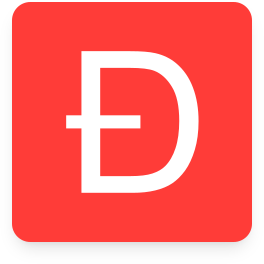
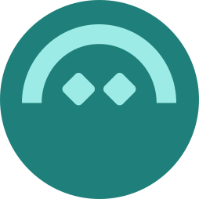
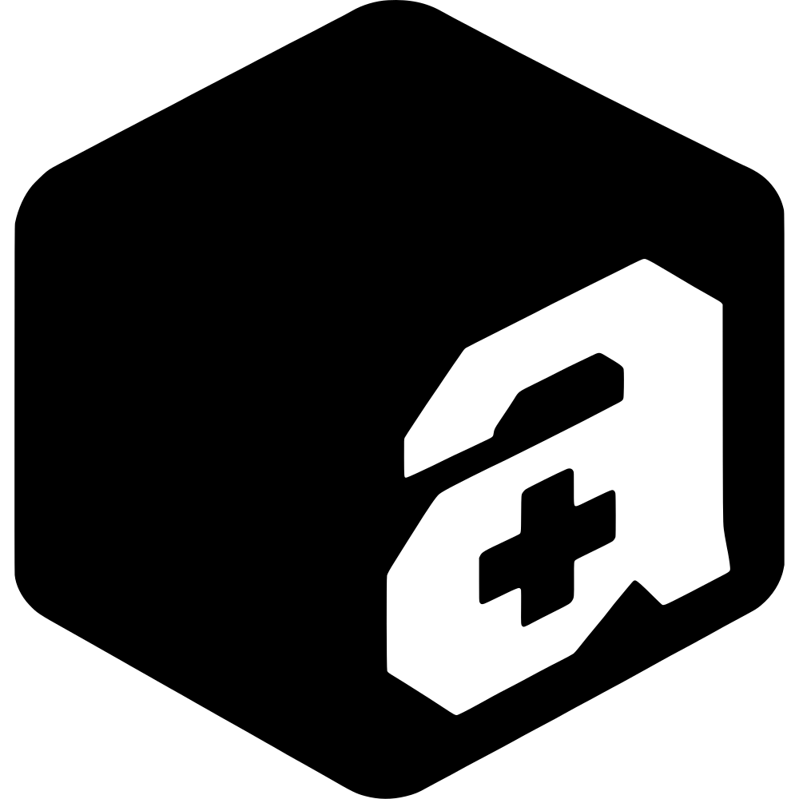
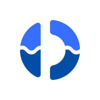
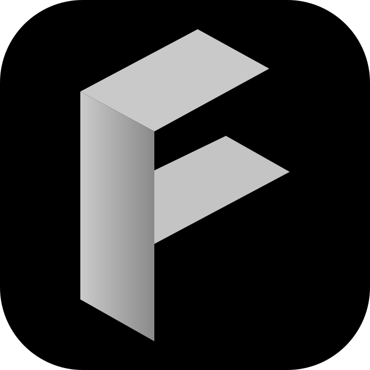

# Hi 👋🏾, I'm Meek

I can help you with smart contract work, auditing, and educational content for EVM blockchains.

## 🎉 Awards

- 2026:  The DAO Fund — Ethereum Security Quadratic funding round
- Sep 2025:  <a href="https://www.uniswapfoundation.org/blog/unichain-grants-4">Uniswap Foundation</a> grant for [Async Swap](https://github.com/asyncswap/async-swap)
- Sep 2023: 🏅 <a href="https://minaminao.github.io/optimizor-war/"> minaminao Optimizor War CTF </a> at  Huff Hackathon
- June 2023: [Star Streamer](https://github.com/mmsaki/star-streamer), 🥇  IPFS, 🥉  libp2p at ETHGlobal HackFS Hackathon
- Jan 2023: [Swipe](https://msaki.io/blog/i-build-a-tinder-for-nfts), 🏆 Top 10 Finalist at  Solana Hackathon Encode Club
- Sep 2022: [Rush](https://msaki.io/blog/aave-flashloans), 🥈 awarded by  Aave DAO Grants at ETHGlobal ETHOnline

## 💼 Work

- May 2025: Co-Founder, <a href="https://asyncswap.org/">  Async Swap Labs </a>
- June 2024 - July 2024: Software Engineer, <a href="https://www.river.ph/">  River </a>
- May 2023 - March 2024: Blockchain Consultant, <a href="https://extropy.io/">  Extropy.io </a>
- Jun 2023 - October 2023: Judge Volunteer, <a href="https://www.ethglobal.com/">  ETHGlobal </a>
- Mar 2023: Mentor, <a href="https://www.chingu.io/">  Chingu </a>
- Jan 2023 - April 2023: Frontend Developer, <a href="https://www.public---assembly.com/">🌐 Public Assembly DAO</a>
- Oct 2022: Blockchain Quantitative Analyst, <a href="https://fluid.io/">  Instadapp Labs </a>

## 🎓 Studies

- Aug 2024 - Oct 2024: Data Structures &amp; Algorithms, <a href="https://www.linkedin.com/school/2636539/">  UC Berkeley Extension </a>
- Jul 2024 - Aug 2024: How to Create &amp; Grow a Startup, <a href="https://www.linkedin.com/school/570834/">  Stanford Continuing Studies </a>
- Oct 2023 - Dec 2023: UI/UX Design, <a href="https://www.uiprep.com/">  UI Prep </a>
- Apr 2023 - November 2024: Blockchain Engineer Fellowship, <a href="https://www.rareskills.io/">  RareSkills </a>
- Jan 2022 - Aug 2022: Fintech Certificate, <a href="https://twin-cities.umn.edu/">  University of Minnesota Boot Camps </a>
- 2013 - 2017: B.A. in Biochemistry, <a href="https://www.linkedin.com/school/38113/">  The College of St. Scholastica </a>

## Projects

-  [Formal Mind](https://formal.team)
-  [Async Swap](https://github.com/asyncswap/async-swap)
- [Solidity Language Server](https://github.com/asyncswap/solidity-language-server)
-  [askmike.how](https://askmike.how)

[More projects](https://msaki.io/projects) · [Website](https://msaki.io) · [Blog](https://msaki.io/blog) · [Follow me](https://x.com/msakiart) · [Email updates](https://msaki.substack.com)
